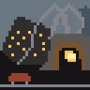
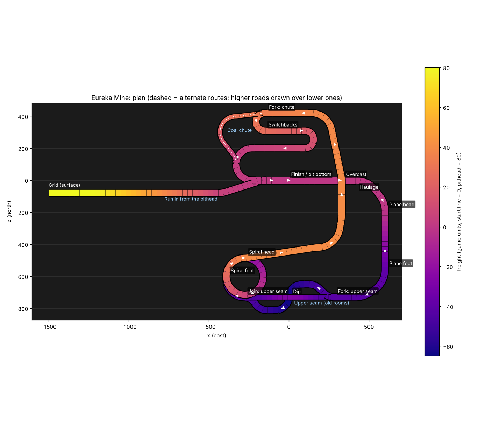

# Eureka Mine for Half Grip

**Version 0.4.7** · for Half Grip Demo 0.419 · needs [HalfGripTools](https://github.com/4l3x4nd3r0/HalfGripTools) 1.0.6 or newer

A race map in a Pennsylvania coal mine. The grid is in the pithead yard under the breaker. The race runs into the drift mouth and
down the slope, and every lap after that is underground. It is dealt into your runs like any other map.

*100% AI generated code.*

## The lap

About **6.5 km** a lap on three levels, plus a 1.4 km run in from the surface on the first lap only.

| Where | What happens there |
|---|---|
| **Pithead yard** | The grid, under the breaker's loading gallery, with the culm banks, a siding of hopper cars and the company houses behind |
| **The slope** | Into the drift mouth and down at about 10% to the pit bottom. Lap 1 only: a timber gate shuts behind the field |
| **Pit bottom and the haulage** | The start line and a long lit straight on the rails |
| **The plane** | A straight 10% drop to the lower gangway. Now and then a string of **runaway mine cars** breaks loose from a heading at the top, runs down the rails in the middle of the plane, and turns off into a heading at the foot |
| **Lower gangway** | **Coal chutes** dump lump coal onto the road. Then the road dives under the old workings |
| **Old workings (alternate)** | The upper seam: dark, rough and slow-gripping, straight across above the dive, and a little shorter |
| **The spiral** | A full turn and a quarter, climbing to the upper gangway |
| **The overcast** | The upper gangway crosses 40 units over the haulage you raced at the start |
| **Switchbacks** | Two hairpins down to the finish |
| **Coal chute (alternate)** | Skips both hairpins, but it is loose coal and two **ventilation doors** swing shut across it. A shut door never stops you: you burst through it and lose some speed |

The bots spread over the alternate routes: each one is dealt one of the four ways round.

## Install

You need Windows and the game on Steam.

### Easy way: the installer

1. Download `HalfGrip-Mods-Installer.exe` from the [HalfGripMods Releases page](https://github.com/4l3x4nd3r0/HalfGripMods/releases)
   (the newest release called "installer") and double-click it.
2. Close the game.
3. Press **+ ADD**, paste `https://github.com/htubdawg/HalfGripEureka` and press **ADD**, then **INSTALL** on Eureka Mine.
4. Start the game from Steam. The first start compiles the mod, which takes a few seconds.

### Manual steps

1. Install BepInEx and [HalfGripTools](https://github.com/4l3x4nd3r0/HalfGripTools) if you have not already (steps 1 and 2 of the
   [HalfGripTools README](https://github.com/4l3x4nd3r0/HalfGripTools#install)).
2. Download this repository (**Code > Download ZIP**) and open the zip.
3. Copy the **`EurekaMine`** folder out of the zip into `<game>\BepInEx\HalfGripMods\`. `mod.json` must sit directly inside
   `HalfGripMods\EurekaMine\`.
4. Start the game. The mod manager in the main menu should list **Eureka Mine**.

## Settings

In `BepInEx\config\halfgrip.eurekamine.cfg`, written the first time the game runs with the mod. Restart the game after changing it.

| Setting | Default | What it does |
|---|---|---|
| `Map.TestMode` | `false` | Every race is in Eureka Mine, to try it out |
| `Map.BenchmarkFactor` | `1.0` | Scales the "finish under X s" objectives. Lower is harder |
| `Surfaces.HaulageGrip` | `1.3` | Grip on the haulage and the slope (1 is the game's plain tarmac) |
| `Surfaces.OldWorkingsGrip`, `OldWorkingsDrag` | `0.85`, `1.4` | Grip (a share of the haulage's) and rolling resistance in the old workings |
| `Surfaces.ChuteGrip`, `ChuteDrag` | `0.68`, `1.35` | Grip (a share of the haulage's) and rolling resistance on the coal chute |
| `Surfaces.YardGrip`, `YardDrag` | `0.92`, `1.15` | Grip and rolling resistance on the yard's gravel |
| `Mine.LampBrightness` | `1.0` | Brightness of the bulbs' light on the rock. Higher is brighter |
| `Mine.Lights` | `8` | Only if the lamps' light can't be painted (the log says so): real lights moved to the lamps nearest the camera. Lower is cheaper |
| `Hazards.RunawayCars`, `CoalChutes`, `VentDoors` | `true` | Switch each hazard on or off |
| `Hazards.DoorSpeedKept` | `0.8` | Share of its speed a car keeps after bursting through a shut door |
| `Debug.ShowPath`, `Debug.VerboseLog` | `false` | Draw the lap and bot paths; write the detailed build log |

## Notes

- The map is built inside the Stadium scene when its race loads, as Highway and Temple of Drift are. If it fails to build, the log
  says why and the Stadium is put back.
- Removing the mod: finish or abandon a run that has Eureka Mine on its map first, then delete the `EurekaMine` folder.
